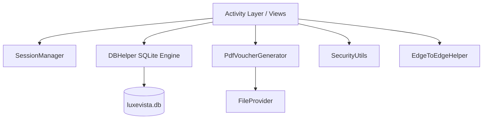

# LuxeVista Resort App

An elegant, native Android luxury hospitality and retreat reservation application crafted in modern Java. LuxeVista Resort App delivers a tailored guest experience featuring suite exploration, atomic room bookings, bespoke service appointments, row-level secure local persistence, and native A4 PDF reservation vouchers.

---

## 1. Project Title — LuxeVista Resort App

**LuxeVista Resort App** (`com.example.luxevistaresortapp`)  
*Luxury Hospitality UI/UX & Standalone Digital Reservation Platform*

---

## 2. Project Overview

LuxeVista Resort App is designed for discerning travelers seeking bespoke coastal retreats and luxury wellness getaways. Built specifically for the Android ecosystem, the application bridges high-end hospitality aesthetics—combining Deep Navy (`#0D1B2A`), Champagne Gold (`#C5A059`), and Warm Ivory (`#FDFBF7`) card surfaces—with robust engineering principles.

The application functions as a **standalone, client-side digital reservation system** backed by Android's native SQLite engine (`DBHelper`). Guests can register secure accounts, explore curated suites and wellness services, create and modify reservations, view their historical booking records, and generate shareable, high-resolution A4 PDF reservation vouchers using Android's native graphics and printing subsystem.

> **CRITICAL ARCHITECTURAL NOTICE & LOCAL STORAGE DISCLAIMER**  
> • All user accounts, suite bookings, and service appointments are persisted strictly in the local SQLite database (`luxevista.db`) on the host device.  
> • Room and service reservations are **not synchronized** with a live central hotel Property Management System (PMS) or remote cloud backend.  
> • The application includes **no real payment gateway integration**; displayed room rates, nightly tariffs, and subtotal figures represent estimated catalog rates for demonstration and retreat planning.  
> • PDF vouchers and digital receipts represent **locally stored reservation records** and do **not** constitute an official hotel confirmation or proof of financial payment.

---

## 3. Key Features

- **Luxury Coastal Visual Language**: Bespoke design system featuring Deep Navy headers, champagne gold accents, warm ivory cards, subtle drop shadows, and edge-to-edge window inset handling.
- **Suite Catalog & Reservation Management**: Full catalog of bespoke rooms (Deluxe Room, Ocean View Suite, Family Room, Luxury Villa) with dynamic calendar date selection, calendar stay calculation, and occupancy controls.
- **Row-Level User Data Isolation**: Strict user-scoped database queries ensure guests access only their own reservations and appointments.
- **Service Appointment Booking**: Dedicated service reservation flow for Spa Treatments, Fine Dining, Poolside Cabanas, and Guided Beach Tours with interactive time-slot selection chips.
- **Redesigned Service Reservation History**: Luxury-styled service booking history matching the room reservation page, complete with appointment reference badges, formatted metadata, and graceful empty-state handling.
- **Native Android A4 PDF Voucher Generation**: Instant generation of branded, high-resolution A4 reservation vouchers via native `android.graphics.pdf.PdfDocument`, without heavy external third-party dependencies.
- **Secure FileProvider Sharing**: Share vouchers via Android's native system Share Sheet (`application/pdf`) utilizing temporary, secure `content://` URIs.
- **Cryptographic Account Security**: Salted SHA-256 password hashing with per-user cryptographically random salts generated via `SecureRandom`.
- **Atomic Database Transactions**: ACID-compliant booking creation and modification routines with conflict detection preventing accidental double bookings.
- **Automated Regression Suite**: 53 unit tests powered by Robolectric validating authentication, database migrations, security isolation, date logic, and PDF generation.

---

## 4. Technology Stack

| Component | Technology | Version / Specification |
| :--- | :--- | :--- |
| **Language** | Java | Java 11 (Source & Target compatibility) |
| **Platform** | Android SDK | Min SDK: `24` (Android 7.0) • Compile SDK: `35` • Target SDK: `35` |
| **Build Tool** | Gradle | Gradle `8.10.2` • Android Gradle Plugin `8.7.3` |
| **JDK Desugaring** | Desugar JDK Libs | `com.android.tools:desugar_jdk_libs:2.1.2` (Java 8+ Time API) |
| **UI Components** | Android Jetpack | AppCompat `1.7.0`, Material Components `1.12.0`, ConstraintLayout `2.2.0` |
| **Persistence** | SQLite | Native Android `SQLiteOpenHelper` (Database Schema Version `6`) |
| **PDF Generation** | Native Android | `android.graphics.pdf.PdfDocument` (A4 595 × 842 points) |
| **File Sharing** | Jetpack Core | `androidx.core.content.FileProvider` |
| **Testing** | JUnit 4 & Robolectric | JUnit `4.13.2`, Robolectric `4.13` (SDK 34 sandbox) |

---

## 5. Application Architecture

LuxeVista Resort App implements an Activity-based Model-View-Controller (MVC) pattern enhanced with centralized service helpers:



- **Activity / View Layer**: Manages layout inflation, UI transitions, window insets, user input capture, and view state binding.
- **Model Layer**: Immutable typed models (`BookingModel`, `ServiceBookingModel`, `UserModel`) ensuring type safety and decoupling the UI from raw database Cursors.
- **Data Access Layer (`DBHelper`)**: Thread-safe singleton managing schema lifecycle, migrations (v1 through v6), atomic transactions, and parameterized SQL queries.
- **Session Layer (`SessionManager`)**: Thread-safe singleton utilizing Android `SharedPreferences` to manage user authentication tokens, active emails, and session tear-down.
- **Security & Formatting Layer (`SecurityUtils`)**: Centralized cryptographic hashing, discrete date range parsing (`java.time.LocalDate`), ChronoUnit calculations, and input validation.
- **Document Generation Layer (`PdfVoucherGenerator`)**: Canvas-driven vector renderer generating standard A4 reservation documents directly into app-specific cache storage.

---

## 6. Room Booking System

The room reservation workflow provides end-to-end management of luxury suite retreats:

1. **Suite Selection**: Catalog browsing with high-resolution imagery and tariff schedules.
2. **Date Picking & Validation**: Check-in and check-out date selection with strict verification:
   - Dates cannot be in the past.
   - Check-out must occur strictly after check-in.
   - Stay nights are computed deterministically using `ChronoUnit.DAYS.between()`, avoiding daylight saving drift.
3. **Occupancy Management**: Stepper controls for adult and child guest counts.
4. **Collision Prevention**: Database verification preventing duplicate active bookings for the same room category and dates by the same user.
5. **Dynamic Reference Generation**: Atomic transaction assigns formatted reference codes (e.g., `LVR-2026-000001`) dynamically utilizing the reservation calendar year.
6. **Modification & Cancellation**: Active reservations may be amended (dates, guests, rates) or cancelled directly from the reservation history view. Cancelled reservations are locked against further modification.

---

## 7. Service Booking System

Complementing room reservations, the resort provides an appointment booking system for on-site amenities:

- **Verified Services**:
  - `Spa Treatments`: Holistic body therapies, aromatherapy, and wellness massages.
  - `Fine Dining`: Chef’s tasting menus, oceanfront private tables, and vintage pairings.
  - `Poolside Cabanas`: VIP shaded cabanas with personal attendant service and day beds.
  - `Guided Beach Tours`: Coastal exploration, reef excursions, and catamaran cruises.
- **Time Slot Chips**: Pre-configured reservation slots (`10:00 AM`, `12:00 PM`, `02:00 PM`, `04:00 PM`, `06:00 PM`, `08:00 PM`).
- **Date Verification**: Future-date validation matching resort operating schedules.
- **Service History Redesign**:
  - Warm Ivory card surfaces (`@drawable/card_luxury_light`) elevated with Champagne Gold borders.
  - Standardized reference badges (`SRV-000001`) derived from verified database row IDs.
  - Status indicator pills (`SAVED LOCALLY`).
  - Strict preservation of authentic data fields (Service name, Customer name, Date, Time) without fabricating unsupported fields.
  - Interactive empty-state view linking directly to service exploration.

---

## 8. Authentication and Session Management

Account security is engineered to prevent credential leakage and cross-account access:

- **Password Cryptography**:
  - Passwords are never stored in plaintext.
  - Each user account receives a unique 16-byte cryptographically secure salt generated via `SecureRandom`.
  - Passwords are salted and hashed using SHA-256 (`SecurityUtils.hashPassword`).
- **Email Normalization**: All user emails are normalized to lowercase (`Locale.US`) and trimmed prior to database storage or lookups.
- **Session Tokens**: Handled via `SessionManager` storing authenticated state in private SharedPreferences.
- **Logout Isolation**: Logging out clears session credentials and directs the user back to the authentication gateway.

---

## 9. SQLite Database Overview

The application utilizes a local SQLite database named **`luxevista.db`** (Schema Version `6`).

### Tables Schema

#### `users` Table
Stores guest registration details and cryptographic credentials.

| Column | Type | Constraints | Description |
| :--- | :--- | :--- | :--- |
| `id` | INTEGER | PRIMARY KEY AUTOINCREMENT | Unique user identifier |
| `name` | TEXT | NOT NULL | Guest full name |
| `email` | TEXT | UNIQUE NOT NULL | Normalized email address |
| `password` | TEXT | NOT NULL | Hex-encoded salted SHA-256 hash |
| `salt` | TEXT | NOT NULL | 16-byte hex-encoded random salt |

#### `bookings` Table
Stores room and suite reservations.

| Column | Type | Constraints | Description |
| :--- | :--- | :--- | :--- |
| `id` | INTEGER | PRIMARY KEY AUTOINCREMENT | Unique booking row ID |
| `roomType` | TEXT | NOT NULL | Reserved suite category name |
| `checkIn` | TEXT | NOT NULL | Check-in date string |
| `checkOut` | TEXT | NOT NULL | Check-out date string |
| `price` | TEXT | NOT NULL | Total reservation subtotal |
| `userEmail` | TEXT | NOT NULL | Owner user email (row-level isolation) |
| `bookingReference` | TEXT | — | Standardized reference (e.g., `LVR-2026-000001`) |
| `nights` | INTEGER | — | Duration of stay in nights |
| `adults` | INTEGER | — | Number of adult guests |
| `children` | INTEGER | — | Number of child guests |
| `status` | TEXT | DEFAULT 'RESERVED' | Reservation status (`RESERVED` / `CANCELLED`) |
| `createdAt` | TEXT | — | Millisecond epoch creation timestamp |

#### `service_bookings` Table
Stores on-site wellness and activity appointments.

| Column | Type | Constraints | Description |
| :--- | :--- | :--- | :--- |
| `id` | INTEGER | PRIMARY KEY AUTOINCREMENT | Unique appointment row ID |
| `serviceName` | TEXT | NOT NULL | Verified service title |
| `customerName` | TEXT | NOT NULL | Guest appointment name |
| `date` | TEXT | NOT NULL | Appointment date |
| `time` | TEXT | NOT NULL | Selected appointment time slot |
| `userEmail` | TEXT | — | Owner user email (row-level isolation) |

---

## 10. Screens and Navigation

```
[LoginActivity] ──> [RegisterActivity]
       │
       ▼
 [HomeActivity] (Bottom Navigation Bar)
   ├── Tab 0: Home (Hero banner, featured suites, quick reservation links)
   ├── Tab 1: Services (Spa, Dining, Cabanas, Beach Tours ──> [BookingActivity])
   ├── Tab 2: Attractions (Resort amenities, private beaches, concierge highlights)
   └── Tab 3: Profile ([ProfileActivity])
         ├── My Reservations ──> [ViewBookingsActivity] ──> [BookingSuccessActivity] (PDF Voucher)
         ├── Service Bookings ──> [ServiceBookingsActivity]
         ├── Room Booking Flow ──> [RoomBookingActivity]
         └── Account Management & Logout
```

---

## 11. Installation Requirements

To compile and execute the application locally:

- **Host Operating System**: Windows 10/11, macOS (12+), or Ubuntu Linux (20.04+).
- **Java Development Kit (JDK)**: OpenJDK 17 or OpenJDK 21 (configured as Gradle JDK).
- **Android SDK**: Android SDK Platform 35 (`compileSdk 35`).
- **Android Build Tools**: `35.0.0` or higher.
- **Physical Device / Emulator**: Android device running Android 7.0 (API Level 24) or higher.

---

## 12. Android Studio Setup

1. Launch **Android Studio** (Ladybug | 2024.2.1 or newer recommended).
2. Select **File > Open...** and navigate to the repository directory:
   `c:\Users\User\OneDrive\Desktop\LuxeVistaResortApp\LuxeVistaResortApp`
3. Allow Gradle to synchronize dependencies.
4. Verify that the Project JDK is set to **Java 17** or **Java 21**:
   **Settings > Build, Execution, Deployment > Build Tools > Gradle > Gradle JDK**.
5. Ensure `local.properties` specifies your local Android SDK location:
   ```properties
   sdk.dir=C\:\\Users\\<Username>\\AppData\\Local\\Android\\Sdk
   ```

---

## 13. Build and Run Instructions

### Building Debug APK via Command Line

Open a terminal or PowerShell in the repository root:

```powershell
# Clean and assemble the debug APK
.\gradlew.bat assembleDebug --no-daemon
```

The compiled APK will be output to:
`app/build/outputs/apk/debug/app-debug.apk`

### Installing and Running on an Android Device

If an Android device or emulator is connected via ADB:

```powershell
# Install the debug APK directly
.\gradlew.bat installDebug --no-daemon
```

Or via ADB directly:

```powershell
adb install -r app\build\outputs\apk\debug\app-debug.apk
```

---

## 14. Testing Instructions

LuxeVista Resort App includes an automated unit and integration test suite executed through Robolectric and JUnit:

### Executing the Test Suite

```powershell
# Run all unit tests
.\gradlew.bat testDebugUnitTest --no-daemon
```

### Verified Test Coverage

The test suite validates 53 automated test cases with 100% pass rates:

1. **`AuthenticationRobolectricTest`** (9 tests): Validates user registration, duplicate email rejection, password salting, SHA-256 verification, and session persistence.
2. **`DatabaseMigrationRobolectricTest`** (11 tests): Validates schema upgrades from version 1 through 6 without data loss, verifying newly introduced columns.
3. **`EdgeToEdgeAndServicesTest`** (4 tests): Tests navigation tab index constants, service names, and date parsing formats.
4. **`ExampleUnitTest`** (1 test): Baseline sanity test.
5. **`HomeAndCatalogTest`** (5 tests): Tests room catalog definitions and home activity initializers.
6. **`SecurityAndValidationTest`** (17 tests): Tests password strength algorithms, date parsing, checkout-after-checkin constraints, and stay night calculations.
7. **`ServiceHistoryAndPdfVoucherRobolectricTest`** (6 tests): Validates service booking data mapping, user ownership isolation, empty-state logic, PDF formatting calculations, PDF file generation, and secure FileProvider URI creation.

---

## 15. Screenshots

> *Screen capture assets are organized under the documentation directory `docs/screenshots/` and reflect the luxury mobile interface.*

| Screen | Description | Status |
| :--- | :--- | :--- |
| **Home Screen** | Luxury hero banner, quick actions, and room recommendations | `docs/screenshots/home_screen.png` *(pending capture)* |
| **Room Catalog** | Suite browsing with nightly tariffs and occupancy specs | `docs/screenshots/rooms_screen.png` *(pending capture)* |
| **Room Voucher** | Digital reservation voucher with reference pill and status | `docs/screenshots/room_voucher.png` *(pending capture)* |
| **PDF Voucher** | High-resolution A4 printable reservation voucher | `docs/screenshots/pdf_voucher.png` *(pending capture)* |
| **Service History** | Redesigned luxury service reservation history cards | `docs/screenshots/service_history.png` *(pending capture)* |

---

## 16. Project Structure

```
LuxeVistaResortApp/
├── .gitignore
├── build.gradle.kts
├── gradle.properties
├── gradlew
├── gradlew.bat
├── settings.gradle.kts
├── README.md
└── app/
    ├── build.gradle.kts
    └── src/
        ├── main/
        │   ├── AndroidManifest.xml
        │   ├── java/com/example/luxevistaresortapp/
        │   │   ├── AttractionsActivity.java
        │   │   ├── BookingActivity.java
        │   │   ├── BookingModel.java
        │   │   ├── BookingSuccessActivity.java
        │   │   ├── DBHelper.java
        │   │   ├── EdgeToEdgeHelper.java
        │   │   ├── HomeActivity.java
        │   │   ├── HotelOffersActivity.java
        │   │   ├── LoginActivity.java
        │   │   ├── MainActivity.java
        │   │   ├── PdfVoucherGenerator.java
        │   │   ├── ProfileActivity.java
        │   │   ├── RegisterActivity.java
        │   │   ├── RoomBookingActivity.java
        │   │   ├── SecurityUtils.java
        │   │   ├── ServiceBookingModel.java
        │   │   ├── ServiceBookingsActivity.java
        │   │   ├── ServicesActivity.java
        │   │   ├── SessionManager.java
        │   │   ├── UserModel.java
        │   │   ├── ViewBookingsActivity.java
        │   │   └── ViewRoomsActivity.java
        │   └── res/
        │       ├── drawable/         (Luxury buttons, cards, vector icons, backgrounds)
        │       ├── layout/           (Activity layouts & list item views)
        │       ├── values/           (colors.xml, strings.xml, themes.xml)
        │       └── xml/              (file_paths.xml, backup_rules.xml)
        └── test/
            └── java/com/example/luxevistaresortapp/
                ├── AuthenticationRobolectricTest.java
                ├── DatabaseMigrationRobolectricTest.java
                ├── EdgeToEdgeAndServicesTest.java
                ├── ExampleUnitTest.java
                ├── HomeAndCatalogTest.java
                ├── SecurityAndValidationTest.java
                └── ServiceHistoryAndPdfVoucherRobolectricTest.java
```

---

## 17. Known Limitations

- **Local Storage Scope**: All data resides strictly inside the app-specific SQLite database on the client device. Reinstalling or clearing application storage removes stored records unless restored via Android Backup.
- **No Remote PMS Backend**: The application does not interface with an enterprise hotel reservation API (e.g., Opera PMS, Amadeus, or Sabre). Room availability is simulated locally.
- **No Financial Processing**: Payment confirmation is not supported; reservation totals are advisory estimates.
- **Single Currency**: Monetary figures are formatted in Sri Lankan Rupees (`Rs.`) without multi-currency foreign exchange conversion.

---

## 18. Future Improvements

- **RESTful Cloud Backend**: Implementation of a Spring Boot or Node.js backend providing centralized room availability synchronization.
- **Payment Gateway Integration**: Secure Stripe or Google Pay SDK integration for credit card tokenization and digital payments.
- **Biometric Authentication**: Fingerprint and Face Unlock support via Android BiometricPrompt API.
- **Push Notifications**: Firebase Cloud Messaging (FCM) integration for reservation reminders and concierge updates.
- **Dark / Light Mode Toggle**: Adaptive theme switching between Midnight Luxury and Radiant Gold.

---

## 19. Author / Developer Information

- **Repository**: [LuxeVistaResortApp on GitHub](https://github.com/januuthayan1967-cloud/LuxeVistaResortApp.git)  
- **Organization / Account**: `januuthayan1967-cloud`  
- **Lead Engineering**: Senior Android Java Engineering Team

---

## 20. License Information

*Proprietary Hospitality Application — All Rights Reserved.*  
No formal open-source license is granted at this time. This repository and its source code are maintained for portfolio presentation, evaluation, and authorized deployment.
